<picture>
  <source media="(prefers-color-scheme: dark)" srcset=".github/assets/hero-dark.svg">
  <source media="(prefers-color-scheme: light)" srcset=".github/assets/hero-light.svg">
  
</picture>

<p align="center">
  <a href="LICENSE"></a>
  <a href="https://github.com/Aboudjem/humanizer-skill/actions/workflows/ci.yml"></a>
  <a href="skills/humanizer/SKILL.md"></a>
</p>

<p align="center">
  <b>English</b> · <a href="READMEs/zh-CN.md">简体中文</a> · <a href="READMEs/ja.md">日本語</a> · <a href="READMEs/es.md">Español</a> · <a href="READMEs/fr.md">Français</a>
</p>

**See why your draft sounds like AI, then fix it.**

Humanizer quotes the words that sound machine-written, then rewrites your draft.

| Know which words | Reads more human | Facts kept |
|:--|:--|:--|
| It quotes each word that sounds like AI. The CLI ranks them in a "Fix first" list. | The bundled example drops from 57 to 6 out of 100. Lower is more human. | The CLI's `compare --check-facts` fails a rewrite that lost a number, date, version or URL. |

**Works with:** any agent that reads skills. It is not tied to one model: the skill is one Markdown file, and your agent's model runs it.

Tested: Codex CLI. Install tested: Claude Code, Cursor, Gemini CLI, GitHub Copilot, OpenCode.

Installs for all your projects:

```bash
npx skills add Aboudjem/humanizer-skill -g
# then, in your agent: /humanizer --file draft.md --voice casual
```

[The example](examples/blog-post/README.md) that ships with the repo, before and after, scored by the CLI:

```text
Before   57/100  Mixed
  In today's rapidly evolving technological landscape, artificial intelligence
  is reshaping how we think about creativity and artistic expression.

After     6/100  Pristine
  Stable Diffusion 1.4 was released on 22 August 2022.

Fact check: OK. All 7 fact(s) in the original survive the rewrite.
```

Lower is more human. [Proof](#proof) names the command that prints these numbers.

**What it is:** a skill that finds the words that sound like AI in your text, and rewrites them.

**When to use it:** before you publish a README, blog post or email that you wrote with AI help.

**What you get:** the rewrite in chat, in one of five voices. Your file changes only with `--mode edit`.

It is not an AI detector, and it does not promise to pass one.

## What you get

A report that starts with the verdict, then says what to fix. This is the optional CLI on the example:

```bash
node cli/index.js score examples/blog-post/before.md
```

```text
examples/blog-post/before.md
Score: 57/100  (Mixed)
Fix first:
  1. Cut the stock AI words: 19 found ("it is worth noting", "it is important to note", "in today's", "rapidly evolving", ...). Costs 40.0 points (lexical).
  2. Vary the sentence lengths: they run from 13 to 37 words (mean 24.4). Split a long one and add a short one. Costs 16.8 points (burstiness).
  3. Rewrite it with the skill (/humanizer --file examples/blog-post/before.md), then run "compare --check-facts" on the pair.
Detail:
  Signal breakdown (points out of 100):
    lexical     40.0   weight 0.4   vocabTellDensity 0.0697
    burstiness  16.8   weight 0.28  burstiness 0.263
    repetition  0.3    weight 0.14  trigramRepetition 0.004
    diversity   0.0    weight 0.18  mattr 0.843
  ... then 12 metric lines
```

- **A 0 to 100 score** with one of five verdicts, from Pristine to Pure AI smell.
- **A "Fix first" list** that names the words and sentences that cost the points.
- **A rewrite in one of five voices**: `casual`, `professional`, `technical`, `warm`, `blunt`.
- **A fact check** that fails a rewrite which lost a number, date, version, URL or acronym.
- **An exit code** for CI, and a [pre-commit hook](docs/pre-commit.md) that scores only the files you staged.

## Install

**Recommended: the Vercel skills CLI.** `npx skills` is Vercel's open installer for agent skills.

```bash
npx skills add Aboudjem/humanizer-skill -g
```

Works in 78 agents: pick yours in the menu ([supported agents](https://github.com/vercel-labs/skills#supported-agents)). It installs for all your projects.

In a terminal, the command shows the agent menu. Without an interactive terminal, it installs into every agent folder, so use `-a <agent>` in scripts.

<a href="https://skills.sh/aboudjem/humanizer-skill"></a> Humanizer's page: [skills.sh/aboudjem/humanizer-skill](https://skills.sh/aboudjem/humanizer-skill).

**Or install straight into one agent.** Each command installs for all your projects.

<p align="center">
  <a href="#install-codex"></a>
  <a href="#install-claude-code"></a>
  <a href="#install-cursor"></a>
  <a href="#install-gemini-cli"></a>
  <a href="#install-github-copilot"></a>
  <a href="#install-opencode"></a>
</p>

<a id="install-codex"></a>**Codex**, tested:

```bash
npx skills add Aboudjem/humanizer-skill -g -a codex
```

<a id="install-claude-code"></a>**Claude Code**, install tested:

```bash
npx skills add Aboudjem/humanizer-skill -g -a claude-code
```

<a id="install-cursor"></a>**Cursor**, install tested:

```bash
npx skills add Aboudjem/humanizer-skill -g -a cursor
```

<a id="install-gemini-cli"></a>**Gemini CLI**, install tested:

```bash
npx skills add Aboudjem/humanizer-skill -g -a gemini-cli
```

<a id="install-github-copilot"></a>**GitHub Copilot**, install tested:

```bash
npx skills add Aboudjem/humanizer-skill -g -a github-copilot
```

<a id="install-opencode"></a>**OpenCode**, install tested:

```bash
npx skills add Aboudjem/humanizer-skill -g -a opencode
```

**Claude Code plugin.** The same skill, from the 10x marketplace. It adds no command or hook:

```bash
claude plugin marketplace add Aboudjem/10x && claude plugin install humanizer@10x
```

Only this project: drop `-g`. Another agent: find its `-a` code in [docs/editors.md](docs/editors.md).

<details>
<summary>Install without an installer (curl)</summary>

This copies the one file the skill needs into your project:

```bash
mkdir -p .claude/skills/humanizer && curl -sL https://raw.githubusercontent.com/Aboudjem/humanizer-skill/main/skills/humanizer/SKILL.md -o .claude/skills/humanizer/SKILL.md
```

Swap `.claude/skills/` for the folder your agent reads. Use `~/.claude/skills/` for a global install.

</details>

## Use it

**1. Rewrite a draft.** In your agent, call the skill on your own file:

```text
/humanizer --file draft.md --voice technical
```

> **Before:** This comprehensive guide delves into the intricacies of our authentication system.
>
> **After:** This guide explains how our authentication system works.

The rewrite cuts the AI habits. It never adds a fact the source did not have.
By default it prints the rewrite in chat and leaves the file as it is. Add `--mode edit` to change the file in place.

**2. Score a file.** The CLI is optional and runs from a clone. It reads the file and changes nothing:

```bash
git clone https://github.com/Aboudjem/humanizer-skill && cd humanizer-skill
node cli/index.js score examples/blog-post/before.md
```

The output is the report under [What you get](#what-you-get). Use the path of your own file.

**3. Check the rewrite kept the facts.** The real risk is a rewrite that drops a number:

```bash
node cli/index.js compare --before examples/blog-post/before.md --after examples/blog-post/after.md --check-facts
```

```text
Score: 57 -> 6  (delta -51)
  ... then 6 metric lines

Fact check:
  OK. All 7 fact(s) in the original survive the rewrite.
```

It exits 1 and names anything lost.

**4. Stop bad drafts in CI** (your automatic checks). `scan --fail-above 40` exits 1 when a draft scores too high. The first output line is `Result: PASS` or `Result: FAIL`:

```bash
node cli/index.js scan docs --fail-above 40
```

## How it works

Your README sounds like a chatbot wrote it. You cannot say which words cause it.
AI-written text has habits you can measure. Every sentence has about the same length. The same safe phrases appear again and again.

| Part      | What it does                                                                   | Where it runs        |
| :-------- | :----------------------------------------------------------------------------- | :------------------- |
| The skill | Names 55 patterns, finds them in your text, and rewrites in one of five voices | Your agent's model   |
| The CLI   | Computes the 0 to 100 score from four signals                                  | Node on your machine |

The skill is one Markdown file, [`SKILL.md`](skills/humanizer/SKILL.md). Your agent reads it when you type `/humanizer`.

The CLI score is plain arithmetic, so the same file always gets the same number:

| Signal     | Weight | What costs points                                           |
| :--------- | :----- | :---------------------------------------------------------- |
| lexical    | 0.40   | Stock AI words and phrases, such as "delve" or "in today's" |
| burstiness | 0.28   | Sentences that are all about the same length                |
| diversity  | 0.18   | A small vocabulary that keeps repeating                     |
| repetition | 0.14   | The same three-word phrases coming back                     |

_Burstiness_ is how much your sentence lengths vary. An _AI tell_ is one of those giveaway habits.

<picture>
  <source media="(prefers-color-scheme: dark)" srcset=".github/assets/demo-burstiness-dark.svg">
  <source media="(prefers-color-scheme: light)" srcset=".github/assets/demo-burstiness-light.svg">
  
</picture>

<details>
<summary>All 55 patterns, by category</summary>

| IDs     | Category           | Examples                                                                          |
| :------ | :----------------- | :-------------------------------------------------------------------------------- |
| P1-P8   | Content            | Significance inflation, promotional language, AI vocabulary ("delve", "leverage") |
| P9-P18  | Language and style | Negative parallelisms, dash overuse, structured-list syndrome                     |
| P19-P21 | Communication      | Chatbot artifacts, knowledge-cutoff disclaimers, sycophantic tone                 |
| P22-P30 | Filler and hedging | Filler phrases, generic conclusions, uniform sentence length                      |
| P31-P43 | Emerging           | Elegant variation, placeholder text, chatbot markup leaks, infomercial hooks      |
| P44-P55 | Craft and forensic | False agency, aphorism formulas, unicode obfuscation, leftover hedge debris       |

Every pattern has its trigger list in [`SKILL.md`](skills/humanizer/SKILL.md). The deep dives are in [`references/patterns.md`](skills/humanizer/references/patterns.md).
The core catalog (P1-P30) draws on [Wikipedia: Signs of AI writing](https://en.wikipedia.org/wiki/Wikipedia:Signs_of_AI_writing) (CC BY-SA).

</details>

## Works with

| Agent               | Install                                                 | Check that ran                                                  | Tested     |
| :------------------ | :------------------------------------------------------ | :-------------------------------------------------------------- | :--------- |
| Claude Code 2.1.326 | `claude plugin install humanizer@10x` | Installed for the user from the 10x marketplace, and validated in strict mode | 2026-11-17 |
| Codex CLI 0.169.0 | `npx skills add Aboudjem/humanizer-skill -g -a codex` | Installed, and the skill rewrote a sentence (project install) | 2026-11-17 |
| Gemini CLI | `npx skills add Aboudjem/humanizer-skill -g -a gemini-cli` | Install only. The skill file landed in `~/.agents/skills/` | 2026-11-17 |
| Cursor | `npx skills add Aboudjem/humanizer-skill -g -a cursor` | Install only. The skill file landed in `~/.agents/skills/` | 2026-11-17 |
| GitHub Copilot | `npx skills add Aboudjem/humanizer-skill -g -a github-copilot` | Install only. The skill file landed in `~/.agents/skills/` | 2026-11-17 |
| OpenCode | `npx skills add Aboudjem/humanizer-skill -g -a opencode` | Install only. The skill file landed in `~/.agents/skills/` | 2026-11-17 |

Each global install was run into an empty home folder on 2026-11-17. Documented, not tested: Windsurf, Zed, Kimi Code CLI and the other agents in [docs/editors.md](docs/editors.md).

The skill is Markdown, so it runs on whatever model your agent uses. It is not tied to one model.

## Proof

Every number on this page comes from a command you can run in a clone.

| Claim                                           | Command                                                                            | It prints                            |
| :---------------------------------------------- | :--------------------------------------------------------------------------------- | :----------------------------------- |
| 90 tests pass                                   | `npm test`                                                                         | `# pass 90` and `# fail 0`           |
| 55 patterns                                     | `grep -cE '^\*\*P[0-9]+: ' skills/humanizer/SKILL.md`                              | `55`                                 |
| The repo passes its own gate                    | `npm run selfcheck`                                                                | `Result: PASS` three times           |
| The example goes from 57 to 6 and keeps 7 facts | the `compare` command in [Use it](#use-it)                                         | `Score: 57 -> 6` and `All 7 fact(s)` |
| The CLI has no dependency                       | `node -p "Object.keys(require('./cli/package.json').dependencies \|\| {}).length"` | `0`                                  |

- CI runs the tests on Node 18 and 20, on every push and pull request.
- CI also runs both install paths: `npx skills add . --list` and `claude plugin validate . --strict`.
- `npm run selfcheck` scores this repo with its own CLI. It also rejects an em dash in any doc.

## FAQ

### Does anything leave my machine?

Not from Humanizer itself. The skill and the CLI make no network call of their own. There is no telemetry, no account and no API key.

The rewrite runs on your agent's model. If that model is hosted, your text goes to it, as with any prompt. The CLI score runs on your machine only.

### Will it make my text pass an AI detector?

That is the wrong goal, and no honest tool can promise it. Detectors change often, and nobody agrees on how well they work on rewritten text. Writing with real variation and concrete detail reads better to people.

### It flagged text I wrote myself. Is it broken?

Probably not, but it can be wrong about you. Some people write even sentences by habit. Detectors also make more mistakes on non-native English writing ([Liang et al.](https://arxiv.org/abs/2304.02819)). Treat the score as a signal.

### Which models does it run on?

Whichever one your agent uses. The runs on this page used Claude Sonnet in Claude Code and the default model in Codex CLI.

### Do I need the CLI?

No. The skill alone rewrites text and estimates a score. The CLI exists for a number that never changes between runs. That is what a CI gate needs.

### Is the CLI on npm?

No. Run it from a clone with `node cli/index.js`. It needs Node 18 or newer and no install step.

The `npx skills` installer is a separate tool. It needs Node 22 or newer.

More answers are in [docs/faq.md](docs/faq.md).

## Limits

- **It is not a detector.** The score reads four text signals. It cannot prove who wrote a text.
- **It does not promise to pass a detector.** It edits the writing, nothing more.
- **The CLI metrics are built for English.** The Chinese pattern appendix is a provisional draft.
- **The skill's own `--score` is a model estimate.** Only the CLI number is the same on every run.
- **The fact check compares tokens, not meaning.** It misses two swapped numbers and a changed claim with no number in it.
- **A sample under 40 words is low-confidence.** `scan` lists it and never fails on it.
- **The rewrite depends on your model.** A weaker model follows the rules less closely.

## Learn more

- [The skill itself](skills/humanizer/SKILL.md), and the [pattern deep dives](skills/humanizer/references/patterns.md)
- [What the score measures](docs/science.md), the research behind the rewrite rules
- [Install in your editor](docs/editors.md), [gate commits](docs/pre-commit.md), [how it compares](docs/comparison.md)
- [The metrics CLI](cli/README.md), the [CHANGELOG](CHANGELOG.md), the [LICENSE](LICENSE)

<p align="center">
  <sub>Built by <a href="https://github.com/Aboudjem">Adam Boudjemaa</a> · MIT License · No telemetry, no data collection</sub>
</p>
