<picture>
  <source media="(prefers-color-scheme: dark)" srcset="../.github/assets/hero-dark.svg">
  <source media="(prefers-color-scheme: light)" srcset="../.github/assets/hero-light.svg">
  
</picture>

<p align="center">
  <a href="../LICENSE"></a>
  <a href="https://github.com/Aboudjem/humanizer-skill/actions/workflows/ci.yml"></a>
  <a href="../skills/humanizer/SKILL.md"></a>
</p>

<p align="center">
  <a href="../README.md">English</a> · <a href="zh-CN.md">简体中文</a> · <a href="ja.md">日本語</a> · <b>Español</b> · <a href="fr.md">Français</a>
</p>

**Descubre qué hace que tu borrador suene a IA. Arréglalo.**

Humanizer encuentra las costumbres que hacen que un texto parezca escrito por una IA. Luego lo reescribe en la voz que elijas.

```bash
claude plugin marketplace add Aboudjem/10x
claude plugin install humanizer@10x
```

Después escribe `/humanizer --file draft.md` en tu editor, donde `draft.md` es cualquier archivo Markdown tuyo. Por defecto muestra la reescritura en el chat y deja el archivo como está. Añade `--mode edit` para cambiar el archivo en su sitio.

Este es el ejemplo incluido, antes y después, puntuado por el CLI:

```text
Before   57/100  Mixed
  In today's rapidly evolving technological landscape, artificial intelligence
  is reshaping how we think about creativity and artistic expression.

After     6/100  Pristine
  Stable Diffusion 1.4 was released on 22 August 2022.

Fact check: OK. All 7 fact(s) in the original survive the rewrite.
```

Cuanto más baja la puntuación, más humano el texto. Ambas líneas abren [el par de ejemplo](../examples/blog-post/README.md), y [Pruebas](#pruebas) da el comando que imprime estas cifras.

Tu README suena a chatbot, y no sabes señalar qué palabras fallan. Las frases hechas se acumulan, y todas las frases miden más o menos lo mismo. Humanizer nombra cada costumbre y puntúa el borrador de 0 a 100. Luego lo reescribe.

## Por qué usarlo

- **Saber qué cambiar.** 55 patrones numerados, y una lista "Fix first" que cita las palabras que restan puntos. [Qué obtienes](#qué-obtienes) muestra una.
- **Conservar tus datos.** `compare --check-facts` hace fallar una reescritura que perdió un número, una fecha, una versión o una URL. El ejemplo de arriba conserva los 7.
- **Bloquear en CI.** `scan --fail-above 40` sale con código 1 si un borrador puntúa demasiado alto. Un [hook de pre-commit](../docs/pre-commit.md) revisa solo los archivos preparados.

No intenta burlar a un detector de IA, y no es uno. Arregla la escritura.

## Qué obtienes

Un informe que empieza por el veredicto y luego dice qué arreglar. Este es el CLI opcional sobre el ejemplo:

```bash
node cli/index.js score examples/blog-post/before.md
```

```text
examples/blog-post/before.md
Score: 57/100  (Mixed)
Fix first:
  1. Cut the stock AI words: 19 found ("it is worth noting", "it is important to note", "in today's", "rapidly evolving", ...). Costs 40.0 points (lexical).
  2. Vary the sentence lengths: they run from 13 to 37 words (mean 24.4). Split a long one and add a short one. Costs 16.8 points (burstiness).
  3. Rewrite it with the skill (/humanizer --file examples/blog-post/before.md), then run "compare --check-facts" on the pair.
Detail:
  Signal breakdown (points out of 100):
    lexical     40.0   weight 0.4   vocabTellDensity 0.0697
    burstiness  16.8   weight 0.28  burstiness 0.263
    repetition  0.3    weight 0.14  trigramRepetition 0.004
    diversity   0.0    weight 0.18  mattr 0.843
  ... then 12 metric lines
```

- **Una puntuación de 0 a 100** con uno de cinco veredictos, de Pristine a Pure AI smell.
- **Una lista "Fix first"** que nombra las palabras y frases que restan puntos.
- **Una reescritura en una de cinco voces**: `casual`, `professional`, `technical`, `warm`, `blunt`.
- **Una comprobación de datos** que hace fallar una reescritura que perdió un número, una fecha, una versión, una URL o una sigla.
- **Un código de salida** para CI, y un [hook de pre-commit](../docs/pre-commit.md) que puntúa solo los archivos preparados.

## Instalación

En Claude Code, a través del marketplace 10x:

```bash
claude plugin marketplace add Aboudjem/10x
claude plugin install humanizer@10x
```

En cualquier otro agente, una línea con el [CLI de skills](https://github.com/vercel-labs/skills):

```bash
npx skills add Aboudjem/humanizer-skill
```

Añade `-a codex`, `-a cursor` u otro código de agente para elegir un solo agente. Los códigos están en [docs/editors.md](../docs/editors.md).

<details>
<summary>Instalar sin instalador (curl)</summary>

Esto copia en tu proyecto el único archivo que necesita la skill:

```bash
mkdir -p .claude/skills/humanizer && curl -sL https://raw.githubusercontent.com/Aboudjem/humanizer-skill/main/skills/humanizer/SKILL.md -o .claude/skills/humanizer/SKILL.md
```

Cambia `.claude/skills/` por la carpeta que lee tu agente. Usa `~/.claude/skills/` para una instalación global.

</details>

## Uso

**1. Reescribe un borrador.** En tu editor, llama a la skill sobre tu propio archivo:

```text
/humanizer --file draft.md --voice technical
```

> **Antes:** This comprehensive guide delves into the intricacies of our authentication system.
>
> **Después:** This guide explains how our authentication system works.

La reescritura quita los tics. Nunca añade un dato que la fuente no tuviera.

**2. Puntúa un archivo.** El CLI es opcional y se ejecuta desde un clon. Lee el archivo y no cambia nada:

```bash
git clone https://github.com/Aboudjem/humanizer-skill && cd humanizer-skill
node cli/index.js score examples/blog-post/before.md
```

La salida es el informe de [Qué obtienes](#qué-obtienes). Pon la ruta de tu propio archivo.

**3. Comprueba que la reescritura conservó los datos.** El riesgo real es una reescritura que pierde un número sin avisar:

```bash
node cli/index.js compare --before examples/blog-post/before.md --after examples/blog-post/after.md --check-facts
```

```text
Score: 57 -> 6  (delta -51)
  ... then 6 metric lines

Fact check:
  OK. All 7 fact(s) in the original survive the rewrite.
```

Sale con código 1 y nombra todo lo que se perdió.

**4. Controla una carpeta.** Una línea para CI. La primera línea de la salida es `Result: PASS` o `Result: FAIL`:

```bash
node cli/index.js scan docs --fail-above 40
```

## Cómo funciona

El texto escrito por IA tiene costumbres que se pueden medir. Las frases miden más o menos lo mismo, vuelven las mismas palabras seguras y el relleno tapa los huecos.

| Parte    | Qué hace                                                                       | Dónde se ejecuta       |
| :------- | :----------------------------------------------------------------------------- | :--------------------- |
| La skill | Nombra 55 patrones, los encuentra en tu texto y reescribe en la voz que elijas | El modelo de tu editor |
| El CLI   | Calcula la puntuación de 0 a 100 a partir de cuatro señales                    | Node en tu máquina     |

La skill es un solo archivo Markdown, [`SKILL.md`](../skills/humanizer/SKILL.md). Tu editor lo lee cuando escribes `/humanizer`.

La puntuación del CLI es aritmética simple, así que el mismo archivo siempre obtiene la misma cifra:

| Señal      | Peso | Qué resta puntos                                            |
| :--------- | :--- | :---------------------------------------------------------- |
| lexical    | 0.40 | Palabras y frases de IA hechas, como "delve" o "in today's" |
| burstiness | 0.28 | Frases que miden todas más o menos lo mismo                 |
| diversity  | 0.18 | Un vocabulario pequeño que se repite                        |
| repetition | 0.14 | Los mismos grupos de tres palabras que vuelven              |

La _burstiness_ es cuánto varía la longitud de tus frases. Un _AI tell_ es una de esas costumbres delatoras.

<picture>
  <source media="(prefers-color-scheme: dark)" srcset="../.github/assets/demo-burstiness-dark.svg">
  <source media="(prefers-color-scheme: light)" srcset="../.github/assets/demo-burstiness-light.svg">
  
</picture>

<details>
<summary>Los 55 patrones, por categoría</summary>

| IDs     | Categoría                 | Ejemplos                                                                                |
| :------ | :------------------------ | :-------------------------------------------------------------------------------------- |
| P1-P8   | Contenido                 | Inflación de importancia, lenguaje promocional, vocabulario de IA ("delve", "leverage") |
| P9-P18  | Lenguaje y estilo         | Paralelismos negativos, abuso de guiones, síndrome de la lista estructurada             |
| P19-P21 | Comunicación              | Restos de chatbot, avisos de fecha de corte, tono adulador                              |
| P22-P30 | Relleno y cautela         | Frases de relleno, conclusiones genéricas, longitud de frase uniforme                   |
| P31-P43 | Emergentes                | Variación elegante, texto de marcador, fugas de marcado de chat, ganchos de teletienda  |
| P44-P55 | Oficio y análisis forense | Falsa agencia, fórmulas de aforismo, ofuscación unicode, restos de cautelas             |

Cada patrón tiene su lista de disparadores en [`SKILL.md`](../skills/humanizer/SKILL.md). Los análisis detallados están en [`references/patterns.md`](../skills/humanizer/references/patterns.md).
El catálogo principal (P1-P30) se basa en [Wikipedia: Signs of AI writing](https://en.wikipedia.org/wiki/Wikipedia:Signs_of_AI_writing) (CC BY-SA).

</details>

## Compatibilidad

| Agente              | Instalación                                             | Comprobación hecha                                                 | Probado    |
| :------------------ | :------------------------------------------------------ | :----------------------------------------------------------------- | :--------- |
| Claude Code 2.1.326 | `claude plugin install humanizer@10x`                   | Instalado desde el marketplace 10x y validado en modo estricto     | 2026-11-17 |
| Codex CLI 0.169.0   | `npx skills add Aboudjem/humanizer-skill -a codex`      | Instalado, y la skill reescribió una frase                         | 2026-11-17 |
| Gemini CLI          | `npx skills add Aboudjem/humanizer-skill -a gemini-cli` | Solo instalación. El archivo de la skill llegó a `.agents/skills/` | 2026-11-17 |
| Cursor              | `npx skills add Aboudjem/humanizer-skill -a cursor`     | Solo instalación. El archivo de la skill llegó a `.agents/skills/` | 2026-11-17 |
| OpenCode            | `npx skills add Aboudjem/humanizer-skill -a opencode`   | Solo instalación. El archivo de la skill llegó a `.agents/skills/` | 2026-11-17 |

Documentados, sin probar: Copilot, Windsurf, Zed, Kimi Code CLI y los demás agentes de [docs/editors.md](../docs/editors.md).

La skill es Markdown, así que se ejecuta en el modelo al que apunte tu editor.

## Pruebas

Cada cifra de esta página sale de un comando que puedes ejecutar en un clon.

| Afirmación                                   | Comando                                                                            | Lo que imprime                     |
| :------------------------------------------- | :--------------------------------------------------------------------------------- | :--------------------------------- |
| Pasan 90 tests                               | `npm test`                                                                         | `# pass 90` y `# fail 0`           |
| 55 patrones                                  | `grep -cE '^\*\*P[0-9]+: ' skills/humanizer/SKILL.md`                              | `55`                               |
| El repo pasa su propio control               | `npm run selfcheck`                                                                | `Result: PASS` tres veces          |
| El ejemplo pasa de 57 a 6 y conserva 7 datos | el comando `compare` de [Uso](#uso)                                                | `Score: 57 -> 6` y `All 7 fact(s)` |
| El CLI no tiene dependencias                 | `node -p "Object.keys(require('./cli/package.json').dependencies \|\| {}).length"` | `0`                                |

- La CI ejecuta los tests en Node 18 y 20, en cada push y cada pull request.
- La CI también ejecuta las dos vías de instalación: `npx skills add . --list` y `claude plugin validate . --strict`.
- `npm run selfcheck` puntúa este repo con su propio CLI. También rechaza cualquier raya larga en un documento.

## Preguntas frecuentes

### ¿Sale algo de mi máquina?

No desde Humanizer. La skill y el CLI no hacen llamadas de red propias. No hay telemetría, ni cuenta, ni clave de API.

La reescritura se ejecuta en el modelo de tu editor. Si ese modelo está alojado, tu texto le llega, como con cualquier prompt. La puntuación del CLI se calcula solo en tu máquina.

### ¿Hará que mi texto pase un detector de IA?

Ese es el objetivo equivocado, y ninguna herramienta honesta puede prometerlo. Los detectores cambian a menudo, y su precisión sobre texto reescrito está en discusión. Una escritura con variación real y detalle concreto se lee mejor para las personas.

### Marcó un texto que escribí yo. ¿Está roto?

Probablemente no, pero puede equivocarse contigo. Hay personas que escriben frases regulares por costumbre. Los detectores también fallan con el inglés de hablantes no nativos ([Liang et al.](https://arxiv.org/abs/2304.02819)). Toma la puntuación como una señal.

### ¿En qué modelos funciona?

En el que use tu editor. Las pruebas de esta página usaron Claude Sonnet en Claude Code y el modelo por defecto de Codex CLI.

### ¿Necesito el CLI?

No. La skill sola reescribe el texto y estima una puntuación. El CLI existe para tener una cifra que no cambia entre ejecuciones. Eso es lo que necesita un control en CI.

### ¿Está el CLI en npm?

No. Ejecútalo desde un clon con `node cli/index.js`. Necesita Node 18 o superior y ningún paso de instalación.

El instalador `npx skills` es otra herramienta. Necesita Node 22 o superior.

Hay más respuestas en [docs/faq.md](../docs/faq.md).

## Límites

- **No es un detector.** La puntuación lee cuatro señales del texto. No puede probar quién escribió un texto.
- **No promete pasar un detector.** Arregla la escritura, nada más.
- **Las métricas del CLI están hechas para el inglés.** El apéndice de patrones en chino es un borrador provisional.
- **El `--score` de la skill es una estimación del modelo.** Solo la cifra del CLI es igual en cada ejecución.
- **La comprobación de datos compara tokens, no significado.** No detecta dos números intercambiados ni una afirmación cambiada sin número.
- **Una muestra de menos de 40 palabras es poco fiable.** `scan` la lista y nunca falla por ella.
- **La reescritura depende de tu modelo.** Un modelo más débil sigue las reglas con menos precisión.

## Más información

- [La skill en sí](../skills/humanizer/SKILL.md) y los [análisis de cada patrón](../skills/humanizer/references/patterns.md)
- [Qué mide la puntuación](../docs/science.md), la investigación detrás de las reglas de reescritura
- [Instalar en tu editor](../docs/editors.md), [controlar los commits](../docs/pre-commit.md), [comparativa](../docs/comparison.md)
- [El CLI de métricas](../cli/README.md), el [CHANGELOG](../CHANGELOG.md), la [LICENCIA](../LICENSE)

<p align="center">
  <sub>Hecho por <a href="https://github.com/Aboudjem">Adam Boudjemaa</a> · Licencia MIT · Sin telemetría, sin recogida de datos</sub>
</p>

<sub>Traducción hecha con ayuda de una máquina a partir del inglés. En caso de duda, manda la <a href="../README.md">versión en inglés</a>.</sub>
