<picture>
  <source media="(prefers-color-scheme: dark)" srcset="../.github/assets/hero-dark.svg">
  <source media="(prefers-color-scheme: light)" srcset="../.github/assets/hero-light.svg">
  
</picture>

<p align="center">
  <a href="../LICENSE"></a>
  <a href="https://github.com/Aboudjem/humanizer-skill/actions/workflows/ci.yml"></a>
  <a href="../skills/humanizer/SKILL.md"></a>
</p>

<p align="center">
  <a href="../README.md">English</a> · <a href="zh-CN.md">简体中文</a> · <a href="ja.md">日本語</a> · <a href="es.md">Español</a> · <b>Français</b>
</p>

**Voyez pourquoi votre brouillon sonne IA, puis corrigez-le.**

Humanizer cite les mots qui sonnent machine, puis réécrit votre brouillon.

| Savoir quels mots | Plus humain à lire | Faits gardés |
|:--|:--|:--|
| Il cite chaque mot qui sonne IA. Le CLI les classe dans une liste « Fix first ». | L'exemple fourni passe de 57 à 6 sur 100. Plus bas, c'est plus humain. | `compare --check-facts` (CLI) échoue si la réécriture a perdu un nombre, une date, une version ou une URL. |

**Compatible avec :** tout agent qui lit des skills. Il n'est lié à aucun modèle : la skill est un seul fichier Markdown, que le modèle de votre agent exécute.

Testé : Codex CLI. Installation testée : Claude Code, Cursor, Gemini CLI, GitHub Copilot, OpenCode.

S'installe pour tous vos projets :

```bash
npx skills add Aboudjem/humanizer-skill -g
# then, in your agent: /humanizer --file draft.md --voice casual
```

[L'exemple](../examples/blog-post/README.md) fourni avec le dépôt, avant et après, noté par le CLI :

```text
Before   57/100  Mixed
  In today's rapidly evolving technological landscape, artificial intelligence
  is reshaping how we think about creativity and artistic expression.

After     6/100  Pristine
  Stable Diffusion 1.4 was released on 22 August 2022.

Fact check: OK. All 7 fact(s) in the original survive the rewrite.
```

Plus le score est bas, plus le texte est humain. La section [Preuves](#preuves) donne la commande qui affiche ces chiffres.

**Ce que c'est :** une skill qui trouve les mots qui sonnent IA dans votre texte, et les réécrit.

**Quand l'utiliser :** avant de publier un README, un article ou un e-mail écrit avec l'aide d'une IA.

**Ce que vous obtenez :** la réécriture dans le chat, dans l'une des cinq voix. Votre fichier ne change qu'avec `--mode edit`.

Ce n'est pas un détecteur d'IA, et il ne promet pas d'en passer un.

## Ce que vous obtenez

Un rapport qui commence par le verdict, puis dit quoi corriger. Voici le CLI optionnel sur l'exemple :

```bash
node cli/index.js score examples/blog-post/before.md
```

```text
examples/blog-post/before.md
Score: 57/100  (Mixed)
Fix first:
  1. Cut the stock AI words: 19 found ("it is worth noting", "it is important to note", "in today's", "rapidly evolving", ...). Costs 40.0 points (lexical).
  2. Vary the sentence lengths: they run from 13 to 37 words (mean 24.4). Split a long one and add a short one. Costs 16.8 points (burstiness).
  3. Rewrite it with the skill (/humanizer --file examples/blog-post/before.md), then run "compare --check-facts" on the pair.
Detail:
  Signal breakdown (points out of 100):
    lexical     40.0   weight 0.4   vocabTellDensity 0.0697
    burstiness  16.8   weight 0.28  burstiness 0.263
    repetition  0.3    weight 0.14  trigramRepetition 0.004
    diversity   0.0    weight 0.18  mattr 0.843
  ... then 12 metric lines
```

- **Un score de 0 à 100** avec l'un des cinq verdicts, de Pristine à Pure AI smell.
- **Une liste « Fix first »** qui nomme les mots et les phrases qui coûtent les points.
- **Une réécriture dans l'une des cinq voix** : `casual`, `professional`, `technical`, `warm`, `blunt`.
- **Une vérification des faits** qui fait échouer une réécriture ayant perdu un nombre, une date, une version, une URL ou un sigle.
- **Un code de sortie** pour la CI, et un [hook pre-commit](../docs/pre-commit.md) qui ne note que les fichiers indexés.

## Installation

**Recommandé : le CLI skills de Vercel.** `npx skills` est l'installeur ouvert de Vercel pour les skills d'agent.

```bash
npx skills add Aboudjem/humanizer-skill -g
```

Fonctionne dans 78 agents : choisissez le vôtre dans le menu ([agents pris en charge](https://github.com/vercel-labs/skills#supported-agents)). Il installe pour tous vos projets.

Dans un terminal, la commande affiche le menu des agents. Sans terminal interactif, elle installe dans le dossier de chaque agent : utilisez donc `-a <agent>` dans les scripts.

<a href="https://skills.sh/aboudjem/humanizer-skill"></a> La page de Humanizer : [skills.sh/aboudjem/humanizer-skill](https://skills.sh/aboudjem/humanizer-skill).

**Ou installez directement dans un agent.** Chaque commande installe pour tous vos projets.

<p align="center">
  <a href="#install-codex"></a>
  <a href="#install-claude-code"></a>
  <a href="#install-cursor"></a>
  <a href="#install-gemini-cli"></a>
  <a href="#install-github-copilot"></a>
  <a href="#install-opencode"></a>
</p>

<a id="install-codex"></a>**Codex**, testé :

```bash
npx skills add Aboudjem/humanizer-skill -g -a codex
```

<a id="install-claude-code"></a>**Claude Code**, installation testée :

```bash
npx skills add Aboudjem/humanizer-skill -g -a claude-code
```

<a id="install-cursor"></a>**Cursor**, installation testée :

```bash
npx skills add Aboudjem/humanizer-skill -g -a cursor
```

<a id="install-gemini-cli"></a>**Gemini CLI**, installation testée :

```bash
npx skills add Aboudjem/humanizer-skill -g -a gemini-cli
```

<a id="install-github-copilot"></a>**GitHub Copilot**, installation testée :

```bash
npx skills add Aboudjem/humanizer-skill -g -a github-copilot
```

<a id="install-opencode"></a>**OpenCode**, installation testée :

```bash
npx skills add Aboudjem/humanizer-skill -g -a opencode
```

**Plugin Claude Code.** La même skill, depuis la place de marché 10x. Il n'ajoute ni commande ni hook :

```bash
claude plugin marketplace add Aboudjem/10x && claude plugin install humanizer@10x
```

Ce projet seulement : retirez `-g`. Un autre agent : son code `-a` est dans [docs/editors.md](../docs/editors.md).

<details>
<summary>Installer sans installeur (curl)</summary>

Cette commande copie dans votre projet le seul fichier dont la skill a besoin :

```bash
mkdir -p .claude/skills/humanizer && curl -sL https://raw.githubusercontent.com/Aboudjem/humanizer-skill/main/skills/humanizer/SKILL.md -o .claude/skills/humanizer/SKILL.md
```

Remplacez `.claude/skills/` par le dossier que lit votre agent. Utilisez `~/.claude/skills/` pour une installation globale.

</details>

## Utilisation

**1. Réécrivez un brouillon.** Dans votre agent, appelez la skill sur votre propre fichier :

```text
/humanizer --file draft.md --voice technical
```

> **Avant :** This comprehensive guide delves into the intricacies of our authentication system.
>
> **Après :** This guide explains how our authentication system works.

La réécriture retire les habitudes d'IA. Elle n'ajoute jamais un fait absent de la source.
Par défaut, la réécriture s'affiche dans le chat et le fichier reste tel quel. Ajoutez `--mode edit` pour modifier le fichier sur place.

**2. Notez un fichier.** Le CLI est optionnel et tourne depuis un clone. Il lit le fichier et ne change rien :

```bash
git clone https://github.com/Aboudjem/humanizer-skill && cd humanizer-skill
node cli/index.js score examples/blog-post/before.md
```

La sortie est le rapport de [Ce que vous obtenez](#ce-que-vous-obtenez). Mettez le chemin de votre propre fichier.

**3. Vérifiez que la réécriture a gardé les faits.** Le vrai risque est une réécriture qui perd un nombre :

```bash
node cli/index.js compare --before examples/blog-post/before.md --after examples/blog-post/after.md --check-facts
```

```text
Score: 57 -> 6  (delta -51)
  ... then 6 metric lines

Fact check:
  OK. All 7 fact(s) in the original survive the rewrite.
```

Il sort en code 1 et nomme ce qui est perdu.

**4. Bloquez les mauvais brouillons en CI** (vos vérifications automatiques). `scan --fail-above 40` sort en code 1 si un brouillon a un score trop haut. La première ligne affiche `Result: PASS` ou `Result: FAIL` :

```bash
node cli/index.js scan docs --fail-above 40
```

## Comment ça marche

Votre README sonne comme un chatbot. Vous ne savez pas dire quels mots en sont la cause.
Un texte écrit par une IA a des habitudes mesurables. Chaque phrase a à peu près la même longueur. Les mêmes formules prudentes reviennent encore et encore.

| Partie   | Ce qu'elle fait                                                               | Où elle tourne             |
| :------- | :---------------------------------------------------------------------------- | :------------------------- |
| La skill | Nomme 55 motifs, les repère dans votre texte, et réécrit dans l'une des cinq voix | Le modèle de votre agent |
| Le CLI   | Calcule le score de 0 à 100 à partir de quatre signaux                        | Node sur votre machine     |

La skill est un seul fichier Markdown, [`SKILL.md`](../skills/humanizer/SKILL.md). Votre agent le lit quand vous tapez `/humanizer`.

Le score du CLI est de l'arithmétique simple, donc un même fichier obtient toujours le même chiffre :

| Signal     | Poids | Ce qui coûte des points                                              |
| :--------- | :---- | :------------------------------------------------------------------- |
| lexical    | 0.40  | Mots et formules IA toutes faites, comme « delve » ou « in today's » |
| burstiness | 0.28  | Des phrases qui font toutes à peu près la même longueur              |
| diversity  | 0.18  | Un petit vocabulaire qui se répète                                   |
| repetition | 0.14  | Les mêmes groupes de trois mots qui reviennent                       |

La _burstiness_ mesure à quel point la longueur de vos phrases varie. Un _AI tell_ est l'une de ces habitudes qui trahissent l'IA.

<picture>
  <source media="(prefers-color-scheme: dark)" srcset="../.github/assets/demo-burstiness-dark.svg">
  <source media="(prefers-color-scheme: light)" srcset="../.github/assets/demo-burstiness-light.svg">
  
</picture>

<details>
<summary>Les 55 motifs, par catégorie</summary>

| IDs     | Catégorie                    | Exemples                                                                                      |
| :------ | :--------------------------- | :-------------------------------------------------------------------------------------------- |
| P1-P8   | Contenu                      | Gonflage de l'importance, langage promotionnel, vocabulaire IA (« delve », « leverage »)      |
| P9-P18  | Langue et style              | Parallélismes négatifs, abus de tirets, syndrome de la liste structurée                       |
| P19-P21 | Communication                | Restes de chatbot, avertissements de date de coupure, ton flatteur                            |
| P22-P30 | Remplissage et prudence      | Formules de remplissage, conclusions passe-partout, phrases de longueur uniforme              |
| P31-P43 | Émergents                    | Variation élégante, texte de remplacement, fuites de balisage de chat, accroches de téléachat |
| P44-P55 | Métier et analyse forensique | Fausse agentivité, formules d'aphorisme, obfuscation unicode, restes de prudences oratoires   |

Chaque motif a sa liste de déclencheurs dans [`SKILL.md`](../skills/humanizer/SKILL.md). Les analyses détaillées sont dans [`references/patterns.md`](../skills/humanizer/references/patterns.md).
Le catalogue principal (P1-P30) s'appuie sur [Wikipedia: Signs of AI writing](https://en.wikipedia.org/wiki/Wikipedia:Signs_of_AI_writing) (CC BY-SA).

</details>

## Compatibilité

| Agent | Installation | Vérification faite | Testé |
| :-- | :-- | :-- | :-- |
| Claude Code 2.1.326 | `claude plugin install humanizer@10x` | Installé pour l'utilisateur depuis la place de marché 10x, et validé en mode strict | 2026-11-17 |
| Codex CLI 0.169.0 | `npx skills add Aboudjem/humanizer-skill -g -a codex` | Installé, et la skill a réécrit une phrase (installation dans le projet) | 2026-11-17 |
| Gemini CLI | `npx skills add Aboudjem/humanizer-skill -g -a gemini-cli` | Installation seule. Le fichier de la skill est arrivé dans `~/.agents/skills/` | 2026-11-17 |
| Cursor | `npx skills add Aboudjem/humanizer-skill -g -a cursor` | Installation seule. Le fichier de la skill est arrivé dans `~/.agents/skills/` | 2026-11-17 |
| GitHub Copilot | `npx skills add Aboudjem/humanizer-skill -g -a github-copilot` | Installation seule. Le fichier de la skill est arrivé dans `~/.agents/skills/` | 2026-11-17 |
| OpenCode | `npx skills add Aboudjem/humanizer-skill -g -a opencode` | Installation seule. Le fichier de la skill est arrivé dans `~/.agents/skills/` | 2026-11-17 |

Chaque installation globale a été lancée dans un dossier personnel vide le 2026-11-17. Documentés, non testés : Windsurf, Zed, Kimi Code CLI et les autres agents de [docs/editors.md](../docs/editors.md).

La skill est du Markdown, elle tourne donc sur le modèle qu'utilise votre agent. Elle n'est liée à aucun modèle.

## Preuves

Chaque chiffre de cette page vient d'une commande que vous pouvez lancer dans un clone.

| Affirmation                                | Commande                                                                           | Ce qu'elle affiche                  |
| :----------------------------------------- | :--------------------------------------------------------------------------------- | :---------------------------------- |
| 90 tests passent                           | `npm test`                                                                         | `# pass 90` et `# fail 0`           |
| 55 motifs                                  | `grep -cE '^\*\*P[0-9]+: ' skills/humanizer/SKILL.md`                              | `55`                                |
| Le dépôt passe son propre contrôle         | `npm run selfcheck`                                                                | `Result: PASS` trois fois           |
| L'exemple passe de 57 à 6 et garde 7 faits | la commande `compare` de [Utilisation](#utilisation)                               | `Score: 57 -> 6` et `All 7 fact(s)` |
| Le CLI n'a aucune dépendance               | `node -p "Object.keys(require('./cli/package.json').dependencies \|\| {}).length"` | `0`                                 |

- La CI lance les tests sur Node 18 et 20, à chaque push et chaque pull request.
- La CI lance aussi les deux voies d'installation : `npx skills add . --list` et `claude plugin validate . --strict`.
- `npm run selfcheck` note ce dépôt avec son propre CLI. Il refuse aussi tout tiret cadratin dans un document.

## FAQ

### Est-ce que quelque chose quitte ma machine ?

Pas depuis Humanizer lui-même. La skill et le CLI ne font aucun appel réseau propre. Pas de télémétrie, pas de compte, pas de clé d'API.

La réécriture tourne sur le modèle de votre agent. Si ce modèle est hébergé, votre texte lui est envoyé, comme pour toute requête. Le score du CLI est calculé sur votre machine seulement.

### Mon texte passera-t-il un détecteur d'IA ?

C'est le mauvais objectif, et aucun outil honnête ne peut le promettre. Les détecteurs changent souvent, et personne n'est d'accord sur leur précision avec un texte réécrit. Une écriture variée et concrète se lit mieux pour des humains.

### Il a signalé un texte que j'ai écrit moi-même. Est-il cassé ?

Probablement pas, mais il peut se tromper sur vous. Certaines personnes écrivent des phrases régulières par habitude. Les détecteurs se trompent aussi sur l'anglais écrit par des non-anglophones ([Liang et al.](https://arxiv.org/abs/2304.02819)). Prenez le score comme un signal.

### Sur quels modèles tourne-t-il ?

Celui qu'utilise votre agent. Les essais de cette page ont utilisé Claude Sonnet dans Claude Code et le modèle par défaut de Codex CLI.

### Ai-je besoin du CLI ?

Non. La skill seule réécrit le texte et estime un score. Le CLI sert à obtenir un chiffre qui ne change jamais d'un lancement à l'autre. C'est ce dont un contrôle en CI a besoin.

### Le CLI est-il sur npm ?

Non. Lancez-le depuis un clone avec `node cli/index.js`. Il demande Node 18 ou plus récent, sans étape d'installation.

L'installeur `npx skills` est un outil séparé. Il demande Node 22 ou plus récent.

D'autres réponses sont dans [docs/faq.md](../docs/faq.md).

## Limites

- **Ce n'est pas un détecteur.** Le score lit quatre signaux du texte. Il ne peut pas prouver qui a écrit un texte.
- **Il ne promet pas de passer un détecteur.** Il corrige l'écriture, rien de plus.
- **Les métriques du CLI sont faites pour l'anglais.** L'annexe des motifs en chinois est un brouillon provisoire.
- **Le `--score` de la skill est une estimation du modèle.** Seul le chiffre du CLI est identique à chaque lancement.
- **La vérification des faits compare des tokens, pas le sens.** Elle rate deux nombres inversés et une affirmation changée sans nombre.
- **Un échantillon de moins de 40 mots est peu fiable.** `scan` le liste et n'échoue jamais dessus.
- **La réécriture dépend de votre modèle.** Un modèle plus faible suit les règles de moins près.

## Pour aller plus loin

- [La skill elle-même](../skills/humanizer/SKILL.md) et les [analyses de chaque motif](../skills/humanizer/references/patterns.md)
- [Ce que mesure le score](../docs/science.md), la recherche derrière les règles de réécriture
- [Installer dans votre éditeur](../docs/editors.md), [contrôler les commits](../docs/pre-commit.md), [comparatif](../docs/comparison.md)
- [Le CLI de métriques](../cli/README.md), le [CHANGELOG](../CHANGELOG.md), la [LICENCE](../LICENSE)

<p align="center">
  <sub>Réalisé par <a href="https://github.com/Aboudjem">Adam Boudjemaa</a> · Licence MIT · Pas de télémétrie, pas de collecte de données</sub>
</p>

<sub>Traduction faite avec l'aide d'une machine à partir de l'anglais. En cas de doute, la <a href="../README.md">version anglaise</a> fait foi.</sub>
