<picture>
  <source media="(prefers-color-scheme: dark)" srcset="../.github/assets/hero-dark.svg">
  <source media="(prefers-color-scheme: light)" srcset="../.github/assets/hero-light.svg">
  
</picture>

<p align="center">
  <a href="../LICENSE"></a>
  <a href="https://github.com/Aboudjem/humanizer-skill/actions/workflows/ci.yml"></a>
  <a href="../skills/humanizer/SKILL.md"></a>
</p>

<p align="center">
  <a href="../README.md">English</a> · <a href="zh-CN.md">简体中文</a> · <b>日本語</b> · <a href="es.md">Español</a> · <a href="fr.md">Français</a>
</p>

**下書きが AI っぽく聞こえる原因を見つけて、直す。**

Humanizer は文章を AI が書いたように見せるクセを見つけ、選んだボイスで書き直します。

```bash
claude plugin marketplace add Aboudjem/10x
claude plugin install humanizer@10x
```

あとはエディタで `/humanizer --file draft.md` と入力します。`draft.md` は手元の任意の Markdown ファイルです。既定では書き直しをチャットに表示し、ファイルはそのまま残します。ファイルをその場で書き換えるには `--mode edit` を付けます。

同梱の例の書き直し前と後を、CLI で採点した結果です。

```text
Before   57/100  Mixed
  In today's rapidly evolving technological landscape, artificial intelligence
  is reshaping how we think about creativity and artistic expression.

After     6/100  Pristine
  Stable Diffusion 1.4 was released on 22 August 2022.

Fact check: OK. All 7 fact(s) in the original survive the rewrite.
```

スコアは低いほど人間らしい文章です。2 行とも[例のペア](../examples/blog-post/README.md)の冒頭で、数字を出すコマンドは[根拠](#根拠)にあります。

README がチャットボットの書いたように読めるのに、どの語が原因か指させない。決まり文句が積み重なり、どの文もだいたい同じ長さになる。Humanizer はそのクセに名前を付けて、下書きを 0 から 100 で採点します。そのうえで書き直します。

## 使う理由

- **何を直すかがわかる。** 番号付きの 55 パターンと、点数を下げている語を引用する「Fix first」リスト。[得られるもの](#得られるもの)に実例があります。
- **事実を守る。** `compare --check-facts` は、数値、日付、バージョン、URL を落とした書き直しを失敗にします。上の例は 7 つすべてを保っています。
- **CI で止める。** `scan --fail-above 40` はスコアが高すぎる下書きで終了コード 1 を返します。[pre-commit フック](../docs/pre-commit.md)はステージしたファイルだけを調べます。

AI 検出器を出し抜くためのツールではなく、検出器でもありません。文章そのものを直します。

## 得られるもの

まず判定を示し、次に直す点を挙げるレポートです。例に対して任意の CLI を実行するとこうなります。

```bash
node cli/index.js score examples/blog-post/before.md
```

```text
examples/blog-post/before.md
Score: 57/100  (Mixed)
Fix first:
  1. Cut the stock AI words: 19 found ("it is worth noting", "it is important to note", "in today's", "rapidly evolving", ...). Costs 40.0 points (lexical).
  2. Vary the sentence lengths: they run from 13 to 37 words (mean 24.4). Split a long one and add a short one. Costs 16.8 points (burstiness).
  3. Rewrite it with the skill (/humanizer --file examples/blog-post/before.md), then run "compare --check-facts" on the pair.
Detail:
  Signal breakdown (points out of 100):
    lexical     40.0   weight 0.4   vocabTellDensity 0.0697
    burstiness  16.8   weight 0.28  burstiness 0.263
    repetition  0.3    weight 0.14  trigramRepetition 0.004
    diversity   0.0    weight 0.18  mattr 0.843
  ... then 12 metric lines
```

- **0 から 100 のスコア**と、Pristine から Pure AI smell までの 5 段階の判定。
- **「Fix first」リスト**。点数を下げている語と文を名指しします。
- **5 つのボイスから選ぶ書き直し**：`casual`、`professional`、`technical`、`warm`、`blunt`。
- **事実チェック**。数値、日付、バージョン、URL、略語を落とした書き直しを失敗にします。
- **CI 用の終了コード**と、ステージしたファイルだけを採点する [pre-commit フック](../docs/pre-commit.md)。

## インストール

Claude Code では 10x マーケットプレイスから入れます。

```bash
claude plugin marketplace add Aboudjem/10x
claude plugin install humanizer@10x
```

ほかのエージェントでは、[skills CLI](https://github.com/vercel-labs/skills) で 1 行です。

```bash
npx skills add Aboudjem/humanizer-skill
```

特定のエージェントだけに入れるには `-a codex`、`-a cursor` などのコードを付けます。コードの一覧は [docs/editors.md](../docs/editors.md) にあります。

<details>
<summary>インストーラなしで入れる（curl）</summary>

スキルに必要な唯一のファイルをプロジェクトにコピーします。

```bash
mkdir -p .claude/skills/humanizer && curl -sL https://raw.githubusercontent.com/Aboudjem/humanizer-skill/main/skills/humanizer/SKILL.md -o .claude/skills/humanizer/SKILL.md
```

`.claude/skills/` はエージェントが読むフォルダに置き換えてください。全体に入れるなら `~/.claude/skills/` を使います。

</details>

## 使い方

**1. 下書きを書き直す。** エディタで、自分のファイルに対してスキルを呼びます。

```text
/humanizer --file draft.md --voice technical
```

> **前：** This comprehensive guide delves into the intricacies of our authentication system.
>
> **後：** This guide explains how our authentication system works.

書き直しは AI のクセを削ります。元の文章にない事実を足すことはありません。

**2. ファイルを採点する。** CLI は任意で、クローンから実行します。ファイルを読むだけで、何も変更しません。

```bash
git clone https://github.com/Aboudjem/humanizer-skill && cd humanizer-skill
node cli/index.js score examples/blog-post/before.md
```

出力は[得られるもの](#得られるもの)のレポートです。パスを自分のファイルに置き換えてください。

**3. 書き直しが事実を保ったか確かめる。** 本当のリスクは、数値が黙って消える書き直しです。

```bash
node cli/index.js compare --before examples/blog-post/before.md --after examples/blog-post/after.md --check-facts
```

```text
Score: 57 -> 6  (delta -51)
  ... then 6 metric lines

Fact check:
  OK. All 7 fact(s) in the original survive the rewrite.
```

何かが失われていれば、終了コード 1 を返してそれを名指しします。

**4. フォルダをゲートする。** CI 用の 1 行です。出力の 1 行目は `Result: PASS` か `Result: FAIL` です。

```bash
node cli/index.js scan docs --fail-above 40
```

## 仕組み

AI が書いた文章には測れるクセがあります。文の長さがそろい、同じ無難な語が繰り返され、つなぎの言葉がすき間を埋めます。

| 部分   | 役割                                                            | 動く場所            |
| :----- | :-------------------------------------------------------------- | :------------------ |
| スキル | 55 パターンに名前を付け、文章から見つけ、選んだボイスで書き直す | エディタのモデル    |
| CLI    | 4 つのシグナルから 0 から 100 のスコアを計算する                | 手元のマシンの Node |

スキルは 1 枚の Markdown ファイル、[`SKILL.md`](../skills/humanizer/SKILL.md) です。`/humanizer` と入力すると、エディタがこれを読みます。

CLI のスコアは単純な計算なので、同じファイルはいつも同じ数字になります。

| シグナル   | 重み | 減点の対象                                        |
| :--------- | :--- | :------------------------------------------------ |
| lexical    | 0.40 | 「delve」や「in today's」のような AI の決まり文句 |
| burstiness | 0.28 | どれもほぼ同じ長さの文                            |
| diversity  | 0.18 | 同じ語ばかり繰り返す狭い語彙                      |
| repetition | 0.14 | 何度も戻ってくる同じ 3 語の並び                   |

_burstiness_ は文の長さのばらつきのことです。_AI tell_ はそうした AI らしさが出るクセのことです。

<picture>
  <source media="(prefers-color-scheme: dark)" srcset="../.github/assets/demo-burstiness-dark.svg">
  <source media="(prefers-color-scheme: light)" srcset="../.github/assets/demo-burstiness-light.svg">
  
</picture>

<details>
<summary>55 パターンの一覧（カテゴリ別）</summary>

| ID      | カテゴリ           | 例                                                                                 |
| :------ | :----------------- | :--------------------------------------------------------------------------------- |
| P1-P8   | 内容               | 重要性の誇張、宣伝調、AI 語彙（「delve」「leverage」）                             |
| P9-P18  | 言葉と文体         | 否定の並列、ダッシュの多用、箇条書き症候群                                         |
| P19-P21 | コミュニケーション | チャットボットの名残、知識の期限の断り書き、へつらう口調                           |
| P22-P30 | つなぎと予防線     | つなぎの言い回し、ありきたりな結論、そろった文の長さ                               |
| P31-P43 | 新しいもの         | 言い換えの連鎖、プレースホルダー文、チャットのマークアップ漏れ、通販番組風のつかみ |
| P44-P55 | 技巧と痕跡         | 偽の主体、格言の型、Unicode による難読化、消し忘れた予防線                         |

各パターンの発動条件は [`SKILL.md`](../skills/humanizer/SKILL.md) にあります。詳しい解説は [`references/patterns.md`](../skills/humanizer/references/patterns.md) にあります。
中核のカタログ（P1-P30）は [Wikipedia: Signs of AI writing](https://en.wikipedia.org/wiki/Wikipedia:Signs_of_AI_writing)（CC BY-SA）に基づきます。

</details>

## 対応エージェント

| エージェント        | インストール                                            | 実施した確認                                            | テスト日   |
| :------------------ | :------------------------------------------------------ | :------------------------------------------------------ | :--------- |
| Claude Code 2.1.326 | `claude plugin install humanizer@10x`                   | 10x マーケットプレイスから導入し、strict モードで検証   | 2026-11-17 |
| Codex CLI 0.169.0   | `npx skills add Aboudjem/humanizer-skill -a codex`      | 導入し、スキルが 1 文を書き直した                       | 2026-11-17 |
| Gemini CLI          | `npx skills add Aboudjem/humanizer-skill -a gemini-cli` | 導入のみ。スキルのファイルが `.agents/skills/` に入った | 2026-11-17 |
| Cursor              | `npx skills add Aboudjem/humanizer-skill -a cursor`     | 導入のみ。スキルのファイルが `.agents/skills/` に入った | 2026-11-17 |
| OpenCode            | `npx skills add Aboudjem/humanizer-skill -a opencode`   | 導入のみ。スキルのファイルが `.agents/skills/` に入った | 2026-11-17 |

文書化のみで未検証のもの：Copilot、Windsurf、Zed、Kimi Code CLI、そのほか [docs/editors.md](../docs/editors.md) にあるエージェント。

スキルは Markdown なので、エディタが使うモデルの上でそのまま動きます。

## 根拠

このページの数字はすべて、クローンで実行できるコマンドから出ています。

| 主張                                    | コマンド                                                                           | 出力                                |
| :-------------------------------------- | :--------------------------------------------------------------------------------- | :---------------------------------- |
| 90 個のテストが通る                     | `npm test`                                                                         | `# pass 90` と `# fail 0`           |
| 55 パターン                             | `grep -cE '^\*\*P[0-9]+: ' skills/humanizer/SKILL.md`                              | `55`                                |
| リポジトリが自分のゲートを通る          | `npm run selfcheck`                                                                | `Result: PASS` が 3 回              |
| 例が 57 から 6 になり、7 つの事実を保つ | [使い方](#使い方)の `compare` コマンド                                             | `Score: 57 -> 6` と `All 7 fact(s)` |
| CLI に依存パッケージがない              | `node -p "Object.keys(require('./cli/package.json').dependencies \|\| {}).length"` | `0`                                 |

- CI は push と pull request のたびに、Node 18 と 20 でテストを実行します。
- CI は 2 つの導入経路も実行します：`npx skills add . --list` と `claude plugin validate . --strict`。
- `npm run selfcheck` はこのリポジトリを自身の CLI で採点します。文書中の em ダッシュも拒否します。

## FAQ

### 何かがマシンの外に出ますか

Humanizer 自身からは出ません。スキルと CLI は独自のネットワーク呼び出しをしません。テレメトリも、アカウントも、API キーもありません。

書き直しはエディタのモデルで動きます。そのモデルがホストされていれば、ほかのプロンプトと同じく文章はそこへ送られます。CLI のスコアは手元のマシンだけで計算します。

### AI 検出器を通るようになりますか

それは目標として間違っていて、誠実なツールなら約束できません。検出器はよく変わり、書き直した文章での精度には異論があります。本物の変化と具体的な細部のある文章は、人にとって読みやすくなります。

### 自分で書いた文章が指摘されました。壊れていますか

おそらく壊れてはいませんが、あなたについて間違えることはあります。文の長さをそろえて書く癖の人もいます。検出器は英語を母語としない人の英文でも誤作動します（[Liang ほか](https://arxiv.org/abs/2304.02819)）。スコアは一つのシグナルとして扱ってください。

### どのモデルで動きますか

エディタが使っているモデルです。このページの実行では、Claude Code の Claude Sonnet と Codex CLI の既定モデルを使いました。

### CLI は必要ですか

いいえ。スキルだけで書き直しとスコアの見積もりができます。CLI は、実行のたびに変わらない数字のためにあります。CI のゲートにはそれが必要です。

### CLI は npm にありますか

いいえ。クローンから `node cli/index.js` で実行します。Node 18 以上が必要で、インストール手順はありません。

`npx skills` のインストーラは別のツールです。Node 22 以上が必要です。

ほかの回答は [docs/faq.md](../docs/faq.md) にあります。

## 限界

- **検出器ではありません。** スコアは文章の 4 つのシグナルを読みます。誰が書いたかは証明できません。
- **検出器を通ることは約束しません。** 文章を直すだけです。
- **CLI の指標は英語向けです。** 中国語のパターン付録は暫定の草稿です。
- **スキルの `--score` はモデルの見積もりです。** 毎回同じになるのは CLI の数字だけです。
- **事実チェックが比べるのはトークンで、意味ではありません。** 2 つの数値の入れ替えや、数値を含まない主張の変更は見逃します。
- **40 語未満のサンプルは信頼度が低くなります。** `scan` は一覧に出しますが、それで失敗にはしません。
- **書き直しの質はモデル次第です。** 弱いモデルほどルールに従う精度が落ちます。

## もっと知る

- [スキル本体](../skills/humanizer/SKILL.md)と[パターンの詳解](../skills/humanizer/references/patterns.md)
- [スコアが測っているもの](../docs/science.md)、書き直しルールの根拠になった研究
- [エディタへの導入](../docs/editors.md)、[コミットのゲート化](../docs/pre-commit.md)、[比較](../docs/comparison.md)
- [指標 CLI](../cli/README.md)、[CHANGELOG](../CHANGELOG.md)、[LICENSE](../LICENSE)

<p align="center">
  <sub>制作: <a href="https://github.com/Aboudjem">Adam Boudjemaa</a> · MIT ライセンス · テレメトリなし、データ収集なし</sub>
</p>

<sub>この文書は英語版からの機械支援翻訳です。差異がある場合は<a href="../README.md">英語版</a>が優先されます。</sub>
