<picture>
  <source media="(prefers-color-scheme: dark)" srcset="../.github/assets/hero-dark.svg">
  <source media="(prefers-color-scheme: light)" srcset="../.github/assets/hero-light.svg">
  
</picture>

<p align="center">
  <a href="../LICENSE"></a>
  <a href="https://github.com/Aboudjem/humanizer-skill/actions/workflows/ci.yml"></a>
  <a href="../skills/humanizer/SKILL.md"></a>
</p>

<p align="center">
  <a href="../README.md">English</a> · <b>简体中文</b> · <a href="ja.md">日本語</a> · <a href="es.md">Español</a> · <a href="fr.md">Français</a>
</p>

**看清你的草稿为什么像 AI，然后改掉。**

Humanizer 引出听起来像机器写的词，然后重写你的草稿。

| 知道是哪些词 | 读起来更像人 | 事实保留 |
|:--|:--|:--|
| 它引出每个像 AI 的词。CLI 把它们排进“Fix first”清单。 | 自带的示例从 57 分降到 6 分（满分 100）。越低越像人写的。 | CLI 的 `compare --check-facts` 会让丢了数字、日期、版本或 URL 的重写失败。 |

**支持：** 任何能读 skill 的代理。它不绑定某个模型：skill 只是一个 Markdown 文件，由你的代理的模型运行。

已测试：Codex CLI。已测试安装：Claude Code、Cursor、Gemini CLI、GitHub Copilot、OpenCode。

为你的所有项目安装：

```bash
npx skills add Aboudjem/humanizer-skill -g
# then, in your agent: /humanizer --file draft.md --voice casual
```

仓库自带的[示例](../examples/blog-post/README.md)，重写前后，由 CLI 打分：

```text
Before   57/100  Mixed
  In today's rapidly evolving technological landscape, artificial intelligence
  is reshaping how we think about creativity and artistic expression.

After     6/100  Pristine
  Stable Diffusion 1.4 was released on 22 August 2022.

Fact check: OK. All 7 fact(s) in the original survive the rewrite.
```

分数越低，越像人写的。打印这些数字的命令见[证据](#证据)。

**它是什么：** 一个 skill，找出你文字里像 AI 的词，并重写它们。

**什么时候用：** 在发布借助 AI 写的 README、博客文章或邮件之前。

**你会得到：** 聊天里的重写结果，用五种风格之一。只有加上 `--mode edit`，你的文件才会改动。

它不是 AI 检测器，也不承诺能通过检测器。

## 你会得到什么

一份先给结论、再说该改什么的报告。下面是可选的 CLI 在示例上的输出：

```bash
node cli/index.js score examples/blog-post/before.md
```

```text
examples/blog-post/before.md
Score: 57/100  (Mixed)
Fix first:
  1. Cut the stock AI words: 19 found ("it is worth noting", "it is important to note", "in today's", "rapidly evolving", ...). Costs 40.0 points (lexical).
  2. Vary the sentence lengths: they run from 13 to 37 words (mean 24.4). Split a long one and add a short one. Costs 16.8 points (burstiness).
  3. Rewrite it with the skill (/humanizer --file examples/blog-post/before.md), then run "compare --check-facts" on the pair.
Detail:
  Signal breakdown (points out of 100):
    lexical     40.0   weight 0.4   vocabTellDensity 0.0697
    burstiness  16.8   weight 0.28  burstiness 0.263
    repetition  0.3    weight 0.14  trigramRepetition 0.004
    diversity   0.0    weight 0.18  mattr 0.843
  ... then 12 metric lines
```

- **0 到 100 的分数**，附五档结论之一，从 Pristine 到 Pure AI smell。
- **「Fix first」清单**，点名扣分的词和句子。
- **五种语音风格之一的重写**：`casual`、`professional`、`technical`、`warm`、`blunt`。
- **事实检查**，丢了数字、日期、版本号、URL 或缩写的重写会失败。
- **给 CI 用的退出码**，以及只给暂存文件打分的 [pre-commit 钩子](../docs/pre-commit.md)。

## 安装

**选择你的代理。** 每条命令都会为你的所有项目安装 Humanizer。

<p align="center">
  <a href="#install-codex"></a>
  <a href="#install-claude-code"></a>
  <a href="#install-cursor"></a>
  <a href="#install-gemini-cli"></a>
  <a href="#install-github-copilot"></a>
  <a href="#install-opencode"></a>
</p>

<a id="install-codex"></a>**Codex**，已测试：

```bash
npx skills add Aboudjem/humanizer-skill -g -a codex
```

<a id="install-claude-code"></a>**Claude Code**，已测试安装：

```bash
claude plugin marketplace add Aboudjem/10x && claude plugin install humanizer@10x
```

<a id="install-cursor"></a>**Cursor**，已测试安装：

```bash
npx skills add Aboudjem/humanizer-skill -g -a cursor
```

<a id="install-gemini-cli"></a>**Gemini CLI**，已测试安装：

```bash
npx skills add Aboudjem/humanizer-skill -g -a gemini-cli
```

<a id="install-github-copilot"></a>**GitHub Copilot**，已测试安装：

```bash
npx skills add Aboudjem/humanizer-skill -g -a github-copilot
```

<a id="install-opencode"></a>**OpenCode**，已测试安装：

```bash
npx skills add Aboudjem/humanizer-skill -g -a opencode
```

只装在当前项目：去掉 `-g`。其他代理：它的 `-a` 代码见 [docs/editors.md](../docs/editors.md)。

<details>
<summary>不用安装器安装（curl）</summary>

这会把 skill 需要的唯一文件复制到你的项目里：

```bash
mkdir -p .claude/skills/humanizer && curl -sL https://raw.githubusercontent.com/Aboudjem/humanizer-skill/main/skills/humanizer/SKILL.md -o .claude/skills/humanizer/SKILL.md
```

把 `.claude/skills/` 换成你的代理读取的文件夹。全局安装用 `~/.claude/skills/`。

</details>

## 使用

**1. 重写草稿。** 在你的代理里，对你自己的文件调用 skill：

```text
/humanizer --file draft.md --voice technical
```

> **之前：** This comprehensive guide delves into the intricacies of our authentication system.
>
> **之后：** This guide explains how our authentication system works.

重写会去掉 AI 的习惯。它从不添加原文没有的事实。
默认情况下，它在聊天里显示重写结果，文件保持不变。加上 `--mode edit` 才会直接修改文件。

**2. 给文件打分。** CLI 是可选的，从克隆的仓库运行。它只读文件，不改任何东西：

```bash
git clone https://github.com/Aboudjem/humanizer-skill && cd humanizer-skill
node cli/index.js score examples/blog-post/before.md
```

输出就是[你会得到什么](#你会得到什么)里的报告。换成你自己文件的路径。

**3. 检查重写有没有保住事实。** 真正的风险是重写丢掉一个数字：

```bash
node cli/index.js compare --before examples/blog-post/before.md --after examples/blog-post/after.md --check-facts
```

```text
Score: 57 -> 6  (delta -51)
  ... then 6 metric lines

Fact check:
  OK. All 7 fact(s) in the original survive the rewrite.
```

它以退出码 1 结束，并列出丢失的内容。

**4. 在 CI 里拦下不好的草稿**（你的自动检查）。草稿分数太高时，`scan --fail-above 40` 以退出码 1 结束。输出第一行是 `Result: PASS` 或 `Result: FAIL`：

```bash
node cli/index.js scan docs --fail-above 40
```

## 工作原理

你的 README 读起来像聊天机器人写的。你说不出是哪些词造成的。
AI 写的文字有可以测量的习惯。每个句子都差不多长。同样稳妥的说法一再出现。

| 部分  | 做什么                                                     | 在哪里运行      |
| :---- | :--------------------------------------------------------- | :-------------- |
| skill | 给 55 个模式命名，在你的文字里找出它们，并用五种风格之一重写 | 你的代理的模型 |
| CLI   | 根据四个信号计算 0 到 100 的分数                           | 你机器上的 Node |

这个 skill 是一个 Markdown 文件，[`SKILL.md`](../skills/humanizer/SKILL.md)。你输入 `/humanizer` 时，代理会读取它。

CLI 的分数是简单的算术，所以同一个文件总是得到同一个数字：

| 信号       | 权重 | 什么会扣分                                       |
| :--------- | :--- | :----------------------------------------------- |
| lexical    | 0.40 | AI 套话和固定说法，比如「delve」或「in today's」 |
| burstiness | 0.28 | 句子都差不多长                                   |
| diversity  | 0.18 | 词汇量小，反复用同样的词                         |
| repetition | 0.14 | 同样的三词短语反复出现                           |

_burstiness_ 指句子长度的变化程度。_AI tell_ 指暴露 AI 痕迹的那类习惯。

<picture>
  <source media="(prefers-color-scheme: dark)" srcset="../.github/assets/demo-burstiness-dark.svg">
  <source media="(prefers-color-scheme: light)" srcset="../.github/assets/demo-burstiness-light.svg">
  
</picture>

<details>
<summary>全部 55 个模式，按类别</summary>

| 编号    | 类别       | 例子                                                 |
| :------ | :--------- | :--------------------------------------------------- |
| P1-P8   | 内容       | 夸大重要性、推销腔、AI 词汇（「delve」「leverage」） |
| P9-P18  | 语言和风格 | 否定式排比、滥用破折号、结构化列表综合征             |
| P19-P21 | 沟通       | 聊天机器人残留、知识截止日期声明、讨好语气           |
| P22-P30 | 填充和含糊 | 填充短语、空泛结论、句长一致                         |
| P31-P43 | 新兴模式   | 刻意换说法、占位文本、聊天标记泄漏、电视购物式开场   |
| P44-P55 | 技法和取证 | 虚假主体、格言套路、Unicode 混淆、残留的含糊措辞     |

每个模式的触发条件都在 [`SKILL.md`](../skills/humanizer/SKILL.md) 里。详细讲解在 [`references/patterns.md`](../skills/humanizer/references/patterns.md)。
核心目录（P1-P30）参考了 [Wikipedia: Signs of AI writing](https://en.wikipedia.org/wiki/Wikipedia:Signs_of_AI_writing)（CC BY-SA）。

</details>

## 支持的代理

| 代理 | 安装 | 做过的检查 | 测试日期 |
| :-- | :-- | :-- | :-- |
| Claude Code 2.1.326 | `claude plugin install humanizer@10x` | 从 10x 市场为用户安装，并在严格模式下验证 | 2026-11-17 |
| Codex CLI 0.169.0 | `npx skills add Aboudjem/humanizer-skill -g -a codex` | 已安装，skill 重写了一个句子（项目内安装） | 2026-11-17 |
| Gemini CLI | `npx skills add Aboudjem/humanizer-skill -g -a gemini-cli` | 仅安装。skill 文件已放入 `~/.agents/skills/` | 2026-11-17 |
| Cursor | `npx skills add Aboudjem/humanizer-skill -g -a cursor` | 仅安装。skill 文件已放入 `~/.agents/skills/` | 2026-11-17 |
| GitHub Copilot | `npx skills add Aboudjem/humanizer-skill -g -a github-copilot` | 仅安装。skill 文件已放入 `~/.agents/skills/` | 2026-11-17 |
| OpenCode | `npx skills add Aboudjem/humanizer-skill -g -a opencode` | 仅安装。skill 文件已放入 `~/.agents/skills/` | 2026-11-17 |

每个全局安装都在 2026-11-17 于一个空的主文件夹里运行过。有文档但未验证：Windsurf、Zed、Kimi Code CLI，以及 [docs/editors.md](../docs/editors.md) 里的其他代理。

skill 是 Markdown，所以它在你的代理所用的模型上运行。它不绑定某个模型。

## 证据

本页的每个数字都来自一条你能在克隆里运行的命令。

| 说法                              | 命令                                                                               | 输出                                |
| :-------------------------------- | :--------------------------------------------------------------------------------- | :---------------------------------- |
| 90 个测试通过                     | `npm test`                                                                         | `# pass 90` 和 `# fail 0`           |
| 55 个模式                         | `grep -cE '^\*\*P[0-9]+: ' skills/humanizer/SKILL.md`                              | `55`                                |
| 仓库通过自己的把关                | `npm run selfcheck`                                                                | 三次 `Result: PASS`                 |
| 示例从 57 降到 6，并保住 7 个事实 | [使用](#使用)里的 `compare` 命令                                                   | `Score: 57 -> 6` 和 `All 7 fact(s)` |
| CLI 没有任何依赖                  | `node -p "Object.keys(require('./cli/package.json').dependencies \|\| {}).length"` | `0`                                 |

- 每次 push 和 pull request，CI 都在 Node 18 和 20 上跑测试。
- CI 也会跑两条安装路径：`npx skills add . --list` 和 `claude plugin validate . --strict`。
- `npm run selfcheck` 用仓库自己的 CLI 给仓库打分。它也拒绝文档里出现 em 破折号。

## 常见问题

### 有东西会离开我的机器吗？

Humanizer 本身不会。skill 和 CLI 自身不发任何网络请求。没有遥测，不需要账号，不需要 API key。

重写由你的代理的模型完成。如果那个模型托管在云端，你的文字会像任何提示词一样发给它。CLI 的分数只在你的机器上计算。

### 它能让我的文字通过 AI 检测器吗？

这个目标本身就不对，诚实的工具也无法承诺。检测器经常变，它们在重写文本上的准确度也有争议。有真实变化和具体细节的文字，人读起来更好。

### 它标出了我自己写的文字。是坏了吗？

多半没坏，但它可能看错你。有些人习惯写长度整齐的句子。检测器在非英语母语者写的英文上也会误判（[Liang 等人](https://arxiv.org/abs/2304.02819)）。把分数当作一个信号。

### 它在哪些模型上运行？

你的代理用哪个就是哪个。本页的运行用的是 Claude Code 里的 Claude Sonnet，和 Codex CLI 的默认模型。

### 我需要 CLI 吗？

不需要。只用 skill 就能重写文字并估算分数。CLI 是为了得到每次运行都不变的数字。CI 把关需要的正是这个。

### CLI 在 npm 上吗？

不在。从克隆里用 `node cli/index.js` 运行。需要 Node 18 或更新版本，不需要安装步骤。

`npx skills` 安装器是另一个工具。它需要 Node 22 或更新版本。

更多回答见 [docs/faq.md](../docs/faq.md)。

## 局限

- **它不是检测器。** 分数读取四个文本信号。它无法证明一段文字是谁写的。
- **它不承诺能通过检测器。** 它只改文字，仅此而已。
- **CLI 的指标是为英文设计的。** 中文模式附录是一份临时草稿。
- **skill 自己的 `--score` 是模型估算。** 只有 CLI 的数字每次都一样。
- **事实检查比对的是词元，不是含义。** 两个数字对调、或不含数字的说法被改了，它都发现不了。
- **少于 40 个词的样本可信度低。** `scan` 会列出它，但从不因此失败。
- **重写效果取决于你的模型。** 越弱的模型越不严格遵守规则。

## 延伸阅读

- [skill 本身](../skills/humanizer/SKILL.md)，以及[模式详解](../skills/humanizer/references/patterns.md)
- [分数量的是什么](../docs/science.md)，改写规则背后的研究
- [在你的编辑器里安装](../docs/editors.md)、[给提交加门禁](../docs/pre-commit.md)、[横向对比](../docs/comparison.md)
- [指标 CLI](../cli/README.md)、[CHANGELOG](../CHANGELOG.md)、[LICENSE](../LICENSE)

<p align="center">
  <sub>由 <a href="https://github.com/Aboudjem">Adam Boudjemaa</a> 制作 · MIT 许可证 · 无遥测，不收集数据</sub>
</p>

<sub>本文档由机器辅助翻译自英文版，如有出入以 <a href="../README.md">英文版</a> 为准。</sub>
